# mymuduo 项目回顾

---
# muduo 启动时序图

这里仅给出 baseLoop 里发生的事, ioLoop 的创建和发生暂定

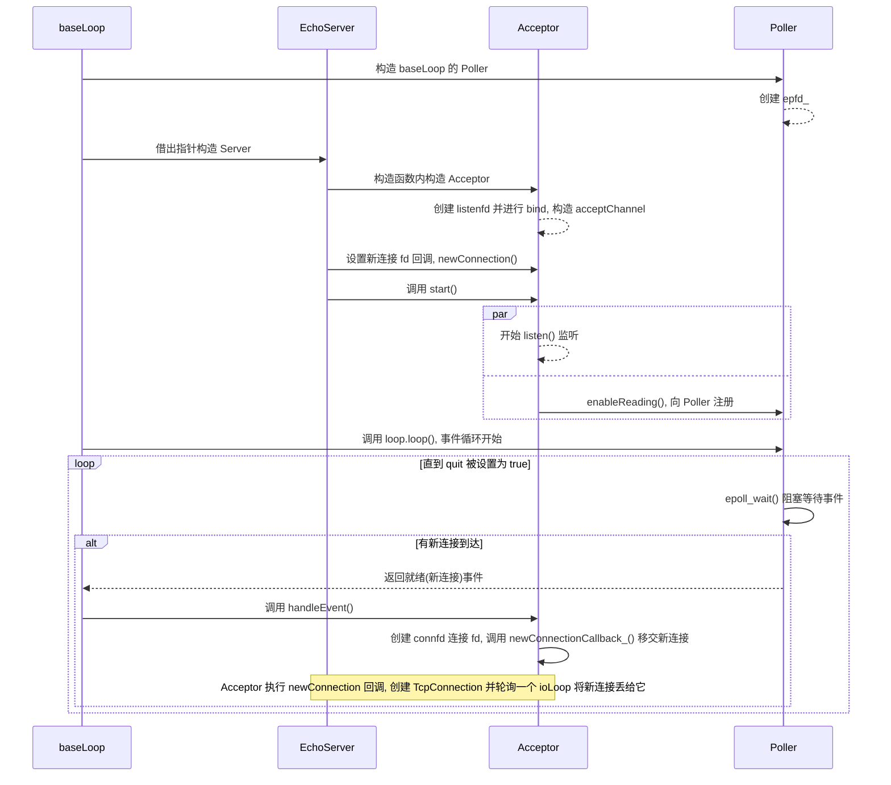


---
# mymuduo 类
---
主要涉及以下几点

- 包含什么类, 充当什么职责, 负责什么生命周期
- 类之间的交互流程, 传递了什么信息
- 类的相关设计原因

---
## Channel

> Channel(频道), 负责封装 **fd**(Poller 监听的对象) 以及 **Callback**(感兴趣的事件回调); fd 资源由上层 Socket/EventLoop 管理, 所以析构不会调用 `close()`. 本身的 `accept/read/write` 由上层设置

### 核心成员

- `fd`: `Poller` 的监听对象, 借用但是**不负责其生命周期**
- `events、revents`: 注册的事件以及 `Poller` 返回的事件
- `callbacks`: 由上层设置的事件回调, 事件发生时得到执行
- `tie`: `std::weak_ptr<void>`, 绑定上层的 `TcpConnection`, 仅对上层进行安全观察连接是否存活，无法保证对象生命周期, 也不延长生命周期


### 详细信息

`Channel` 主要有三类: 1. **listenFd**->由 `Acceptor` 进行管理, 专门用来处理新连接到来时的相关回调. 2.**connFd**->由 `TcpConnection` 进行管理, 专门用来处理连接的 IO 事件回调. 3.**wakeupFd**->由 `EventLoop` 进行管理, 专门用来唤醒当前 loop 所属的线程, 让 loop 从 pollout 阻塞中出来继续往下执行


`Channel` 的上层, 就是谁负责**持有**, 也有三类, 就是以上提到的, 但对于 `EventLoop` 严格来说只负责持有 **wakeupChannel**, 自身维护的 **activeChannls** 保存借用指针, 不拥有连接


`Channel` 无法直接与 `Poller` 交互通信, 那 `Channel` 是如何确保自己在 `Poller` 中的注册、更新、销毁的呢? 答案显而易见-- `EventLoop`, 这里可以理解为 `EventLoop` 为中间人, 在 `Channel` 中注册为了观察者, `Channel` 发生变化调用 update()/remove() 等函数方法进行通知 `EventLoop`, `EventLoop` 用 updateChannel()/removeChannel() 将更新任务转交给 `Poller` 再进行相关处理


同理, `Channel` 的事件处理, 同样依靠 `EventLoop` 作为中间人, 在 loop() 循环中调用 `Poller` 的 poll() 得到就绪队列, 逐个通知 `Channel` 调用 handleEvent(), 也就是事件处理


这就来到的 `Channel` 的核心函数 **handleEvent()**, 我们封装 `Channel` 类就是为了执行相关事件回调, 在聊核心函数前我们得知道 `Channel` 是如何知道自己应该执行怎么样的回调, 上层调用者可能注册了所有的回调, 却只想让我们关心读事件或写事件


事件关心机制 -- **Bitwise**, 也就是位操作, `Channel` 没有维护枚举类用来设置应该关心的事件状态, 因为 POLL 操作直接通过位操作传递信息, 而位掩码允许多个事件组合, 所以维护了两个成员变量 **events/revents** , events 表示 fd 当前希望监听什么, 由上层设置启用或禁用; revents 表示本轮 poller 返回应该发生的事件有哪些, 由 poller 在填充就绪队列时进行设置. 函数 isNoneEvent() 检查 `events == 0`, 并不表示本轮没有就绪事件


知道了想要发生什么以及会发生什么, 核心函数 **handleEvent()** 负责执行回调, 首先检测 tied_ 用于查看绑定的上层对象是否存活, 接着处理相应的事件, 处理顺序如下

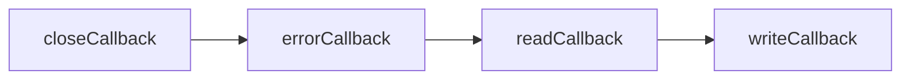

| 条件                            | 行为                      |
| ----------------------------- | ----------------------- |
| `EPOLLHUP` 且没有 `EPOLLIN`      | 调用关闭回调并直接返回             |
| `EPOLLERR`                    | 调用错误回调; 若当前取消了全部关注, 则返回 |
| `EPOLLIN/EPOLLPRI/EPOLLRDHUP` | 调用读回调; 若当前已取消全部关注, 则返回  |
| `EPOLLOUT`                    | 调用写回调                   |

所以这些回调并非每次依次全部执行. HUP 伴随可读事件时会进入读取路径, 给上层消费剩余数据的机会; RDHUP 也交给读回调处理


接着便是 **tie_** 成员, 这点会在上层 `TcpConnection` 详细阐述. 最后便是 `Channel` 析构的约束, 在析构前会进行断言, 意思是 **Channel 析构前必须已从 Poller 移除，且不能正在处理事件**, 这也是 `removeChannel` 必须先于 Channel 析构的原因


**Channel 不拥有 fd，但严格依赖所属 EventLoop、fd 和上层对象的有效期**.


---
## Poller 和 EPollPoller -- Demutiplexer 事件分发器

> Poller(事件分发器), 负责**监听**事件是否就绪, 返回**就绪**的 Channel 队列

### 核心成员

+ `ownerLoop`(隶属 `Poller` 类): 借用所属 EventLoop 指针
+ `channels`(隶属 `Poller` 类):  哈希表 `std::unordered_map<int, Channel *>` , 自我维护一个 channel 的注册表, 通过 fd->channel 进行映射, 
+ `events`(隶属 `EPollPoller` 类): `std::vector<epoll_event>`, 充当 epoll_wait 的就绪事件缓冲区
+ `epfd`(隶属 `EPollPoller` 类): 用于 epoll 相关操作使用的文件描述符


### 详细信息

`Poller` 采用继承机制, 作为父类, 提供**操作/更新** `Channel` 函数接口, 还有核心 `poll()` 函数接口, 通过纯虚函数等待子类重写实现


`EPollPoller` 继承 `Poller`，并实现其纯虚接口, 主要采用 epoll 的 io 方式, 封装其相关操作. `EPollPoller` 是如何知道 `Channel` 状态的?

先说明两类状态, 一是`channels_` 记录哪些 Channel 仍由 Poller 管理; `index_` 区分未管理、已注册、已暂停三个阶段; `addedToLoop_` 与是否仍受管理保持一致

| **addedToLoop** | 意义           |
| --------------- | ------------ |
| `false`         | 未由 poller 管理 |
| `true`          | 已由 poller 管理 |


| 原状态        | 当前关注事件 | 操作           | 成功后状态      |
| ---------- | ------ | ------------ | ---------- |
| `kNew`     | 空      | 无操作          | `kNew`     |
| `kNew`     | 非空     | 登记管理表，执行 ADD | `kAdded`   |
| `kAdded`   | 非空     | MOD          | `kAdded`   |
| `kAdded`   | 空      | DEL，保留管理记录   | `kDeleted` |
| `kDeleted` | 非空     | ADD          | `kAdded`   |
| `kDeleted` | 空      | 无操作          | `kDeleted` |


`EPollPoller` 采用了两个个函数来更改 `Channel` 的状态, 更新/移除, 分别对应 `updateChannel/removeChannel` 函数, 将最后的 `EPOLL_CTL_xxx` 事件分发给 `update` 函数进行处理, 相关行为如下

| 函数名           | `kNew`                    | `kAdded`              | `kDeleted` |
| ------------- | ------------------------- | --------------------- | ---------- |
| updateChannel | 有事件则管理并注册到 epoll, 无事件直接返回 | 还有事件则更新, 否则暂停监听但是保留管理 | 重新注册       |
| removeChannel | 无需删除, 直接返回                | 从 epoll 中删除, 并移除管理    | 移除管理       |


`EPollPoller` 将 `::epoll_ctl` 封装为 `update()` 函数, 使用参数 operation -> 统一处理 **EPOLL_CTL_ADD<->EPOLL_CTL_MOD<->EPOLL_CTL_DEL**


`EPollPoller` 核心函数将 `::epoll_wait` 封装为 `poll()` 函数, 根据 wait 的返回值, 决定是**填充活跃队列, 超时无事发生还是抛出异常**. 需要注意的是 `events` 在充满时会进行**手动扩容**, 为下一轮事件做准备


一次完整的事件监听到执行如下:
>update(): 将 Channel * 放进 epoll_event.data.ptr 
>--> epoll_wait(): 返回该指针和本轮就绪事件
>--> fillActiveChannel(): 取回 Channel * , 设置 revents_ 并加入活跃列表
>--> EventLoop(): 遍历列表, 调用 Channel::handleEvent()


**EventLoop 通过 `unique_ptr<Poller>` 拥有具体后端; Poller 借用所属 EventLoop, 并借用 Channel 指针. EPollPoller 拥有 epfd, 在析构时关闭它; 关闭 epfd 不会关闭被监听的业务 fd. poll、更新和移除操作必须在所属 EventLoop 线程执行**


---
## EventLoop -- Reactor 反应堆

> EventLoop(事件循环), 负责该线程内的事件处理逻辑, 用于 `Channel` 和 `Poller` 两大类, 循环得到 `Poller` 返回的就绪队列, 并通知 `Channel` 进行事件处理. 同时维护 `pendingFunctors` 任务队列, 用于处理当前或其他提交的任务(例如退出等等). 核心思想: one loop peer thread

### 核心成员

+ `activeChannels`: `std::vector<Channel *>`, 来自 `Poller` 返回的活跃的频道对象, 仅借用指针, 在 loop() 中通知对象处理对应感兴趣的事件
+ `poller`: `std::unique_ptr<Poller>`, 当前 loop 维护的事件分发器
+ `wakeupFd`: 被封装为 wakeupChannel(`std::unique_ptr<Channel>`), 隶属于当前的 loop 对象, 注册在当前 loop 对象的 poller 中, 可往该 fd 对象写数据, 使当前 loop 得到唤醒, `muduo` 使用的任务队列靠此做到跨线程通知
+ `pendingFunctors`: `std::vector<Functor>`, 回调容器, loop 存储的所有需要执行的回调操作
+ `mutex`: 互斥锁, 保护多线程下回调容器的线程安全


### 详细信息

`EventLoop` 对象比较特殊, 基本在很多类都注册了它的裸指针, 当它是工作线程时就是 subLoop, 它的**生命周期**依赖于 `EventLoopThread`, 在函数 `threadFunc()` 中创建了栈上的变量, 对应 one loop per thread. 当它是主线程时, 就是 baseLoop


**one loop per thread** 如何得到保证的, EventLoop 只是保证了对象无法拷贝, 并没有保证对象无法重复创建, 所以每个本地线程单独维护 `loopPtr` (thread_local) 指针记录当前存在的 loop 实例, 保证每个线程最多有一个 loop 实例存活


`EventLoop` 对象的作用在 `Channel` 里面已经阐述得比较完整了, 充当频道和事件分发器之前的**中间人**, **循环驱动相关事件的执行**. 一个简单的完整骨架如下:

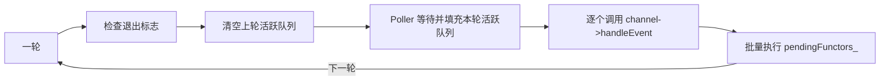


这里着重提 `wakupChannel`, 也就是跨线程的通知唤醒机制.`wakupChannel` 的相关**生命周期**如下. 在 `EventLoop` 的构造函数中进行 wakeupChannel 成员的初始化, 并且设置了读回调, 同时将自己被管理并注册到当前 `EventLoop` 维护的 `Poller` 事件分发器进行监听, 在析构函数中进行 wakeupChannel 的取消监听以及 channels 的取消管理, 最后调用 `::close()` 释放 wakupFd 的资源, 再次印证了 `Channel` 仅借用不持有 fd 的设计理念.


那**唤醒机制**到底怎么做的, 别忘了 `Poller` 此刻正在监听 wakeupFd 的数据到来, 一旦事件就绪, loop 得到活跃频道就会逐个通知 channel 进行事件处理, 这里除了有业务事件, 同样包含了**唤醒事件**, 这时 loop 设置的 `handleRead()` 在频道的 `handleEvent()` 得到执行, 具体的逻辑其实就是消费了 8 字节的数据而已. 可喜可贺的是 `EventLoop` 已经提供了写函数 `wakeup()`, 所以(其他线程)外部者拿到当前 loop 的指针, 希望 loop 不再阻塞在 poller 的 poll()中, 于是调用 `wakeup()` 函数, 就能做到对 loop 的唤醒. 相关时间线如下

> (其他线程)loop->wakeup() **==>** (loop线程)poller->poll()返回活跃channel **==>** (loop线程)活跃队列channel->handleEvent() **==>** (其中唤醒频道)wakeupChannl->readCallback_() **==>** (由loop设置的)handleRead()将数据读出


pendingFunctors_ 保存待执行任务，eventfd 负责通知正在等待的 loop；唤醒后，loop 继续处理事件、任务与退出条件。


再说说 `pendingFunctors` 任务队列存在的意义, 还有其添加和消费方式. 它就是**生产者-消费者**模型: 其他线程是生产者(`queueInLoop` 加任务 + `wakeup`), loop 线程是消费者(`doPendingFunctors` 批量取任务). 
首先是**添加方式**, 注意有两种, 可整理出以下语义:

|调用位置|`runInLoop()`|`queueInLoop()`|
|---|---|---|
|所属 loop 线程|立即调用，可能产生同步重入|始终入队|
|其他线程|转为入队|入队|


`queueInLoop` 加任务, 接受 cb 任务使用互斥锁将任务加入 `pendingFunctors`, 最后依据以下变量决定是否唤醒线程

| 变量                        | 唤醒原因                                                                   |
| ------------------------- | ---------------------------------------------------------------------- |
| !`isInLoopThread()`       | 使用唤醒说明 loop 不在当前线程                                                     |
| `callingPendingFunctors_` | **本线程**正在执行 `doPendingFunctors` 时又有新任务进来, 为了不让循环再次阻塞在 `poll()` 中, 选择唤醒 |
| !`looping`                | 循环尚未开始时, 通知能让首次等待及时返回; 已经调用过 `quit()` 后再入队, 不保证任务会执行                   |


然后是 `doPendingFunctors()` **消费任务**, 我们可以选择遍历任务队列, 接着逐个执行任务, 但是这里有**两个问题**: 1.任务执行耗时且结束后需要**删除**, 而修改任务队列**需要锁保护**, 这里锁的粒度怎么把握? 2.我们拿大锁将整个取任务并执行锁住, 这时来了**新任务怎么办**? 怎么保证任务的重入?


两个问题其实使用当前的方法便可迎刃而解, 那就是使用**栈上临时变量**. 我们用栈变量 `functors` 进行 `std::swap()`,  持锁交换两个 vector 的内部缓冲区及大小、容量等管理信息, 将整批任务转交给局部容器, 随后释放锁, 再执行任务.这样 `pendingFunctors_` 相当于干净的新任务队列, 栈变量 `functors` 拿到了老的所有任务并一一执行, 达到以下效果
+ 指针交换锁的粒度小, 栈变量该线程独有, 函数结束时相关回调对象安全释放
+ 新任务来了就放进 `pendingFuctors_`, 等待下轮循环被执行


quit() 请求结束事件循环, 不提供“排空全部待办任务”的保证. 若在 loop() 开始前调用 quit(), 循环不会进入; 再次调用 loop() 也不会自动清除退出标志.


**EventLoop 必须在所属线程、循环已经停止时析构. 析构会注销唤醒 Channel、关闭 eventfd, 并清除本线程的 `loopPtr`; 其他对象应提前完成其 Channel 的清理, 借用 loop 指针的调用和任务也必须满足有效期要求.**


---
## EventLoopThread

>EventLoopThread(事件线程), 负责对 `EventLoop` 和 `Thread` 进行封装, 统一**线程建立**以及**循环开始**的逻辑. EventLoopThread 管理一个工作线程, 在该线程中创建、初始化并运行 EventLoop, 向控制线程发布借用指针, 并在析构时请求退出、等待线程结束


### 核心成员
+ `loop_`: `EventLoop *`, 虽然是指针, 但是绑定在工作线程上的**栈对象**, 所以也是借用, 不拥有所有权
+ `callback`: 回调函数, 由上层进行设置, 在 loop 对象刚得到创建时得到执行
+ `thread`: `std::unique_ptr<Thread>`, 线程成员, 语义为**构造即为启动**(这与原 muduo 不同, muduo 线程需要 `start()` 手动开启)


### 详细信息

`EventLoopThread` 虽说是单个线程的维度, 但是其实另外开启了一个子线程, 将**回调任务**以及 **loop 循环**交给子线程去执行. 该类其实就两个函数, 下面简单阐述


`startLoop()` -- 构造子线程, 将 `callback` 回调交给它执行, **阻塞直到新线程构造完成或者运行完成**, 最后返回成员 `loop_` 指针(已指向栈变量)
`thread` 语义是**构造即运行**, 我们将`threadFunc()` 交给子线程运行, 所以在子线程中, 我们创建**栈变量 loop** 并将成员` loop_` 指针借用它, 通过 **loop.loop()** 开启循环, 在 loop 循环结束时将指针置空, 并且通知父线程


`EventLoopThread` 同样是该类的核心函数之一. 相关执行顺序如下:

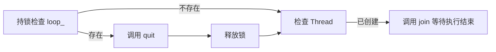

这里有两个设计原因：

- 必须释放锁后再 `join()`: 工作线程退出时也需要取得同一把锁, 才能清空 `loop_`; 持锁等待会造成死锁
- 即使 `loop_` 已经为空, 仍需 `join()`: 循环结束与线程资源回收是两个阶段


---
## EventLoopThreadPool

>EventLoopThreadPool(线程池), 管理多个 `EventLoopThread`(事件线程), 将新连接通过**轮询**分发给相应的 EventLoop

### 核心成员

+ `baseLoop`: 外部的**主循环**, 仅**借用**不负责释放
+ `numThreads`: 额外创建的**工作线程数量**, 不包含 baseLoop
+ `next`: 用于轮询 subLoop 时使用的下标
+ `threads`: `vector<unique_ptr<EventLoopThread>>` 工作线程存储器, 负责每个子线程的启动
+ `loops`: `vector<EventLoop *>` 借用工作线程栈上的 loop, 不包含 baseLoop


### 详细信息

`EventLoopThreadPool` 管理多个 `EventLoopThread`, 负责工作循环的启动与回收, 并通过轮询为新连接选择所属 EventLoop


启动和分配分别由 `start()` 和 `getNextLoop()` 完成. `start()` 根据数量创建 `threads` 线程池和设置回调, 并且填充 `loops` 借用队列, 如果服务器仅有一个线程--主线程, 则直接在 baseLoop 中运行回调. 回调执行位置见下表:

|配置|初始化回调|
|---|---|
|工作线程数大于 0|在每个工作线程中各执行一次|
|工作线程数等于 0|在 baseLoop 所属线程执行一次|


线程的销毁由 `EventLoopThreadPool` 的析构完成, 相关成员析构存在以下顺序:

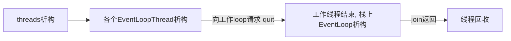

TcpServer 负责安排顺序：先完成连接清理，再释放线程池。工作线程的停止和回收，通过上述析构链完成。


轮询函数的相关规则见下表:

|情况|`getNextLoop()`|`getAllLoops()`|
|---|---|---|
|有工作线程|仅轮询工作 loop|返回全部工作 loop|
|没有工作线程|返回 baseLoop|返回只包含 baseLoop 的容器|

轮询按调用次数推进, 不检查实际负载. TcpServer 在接入新连接时进行选择, 已建立连接继续由原来的 ioLoop 处理


构造、配置、启动、查询和析构都必须在 **baseLoop 所属线程**串行执行, 包括 `started()`、`name()` 等查询. 因此 `next_` 和两个启动状态无需依赖原子操作来支持并发访问.


---
## Acceptor

>Acceptor(连接监听者), 运行在 baseLoop 中,  封装 `listenFd`, 负责监听新连接的到来, 创建 `connFd` 并且移交所有权

### 核心成员:
+ `acceptSocket`: 保管 `listenFd`, 负责绑定 ip 和 port , fd 的相关设置以及 fd 资源的释放
+ `acceptChannel`: 注册在 baseLoop 的 `Poller` 中, 管理监听事件, fd 由 Socket 保管持有
+ `nweConnectionCallback`: 连接建立时负责执行的回调, 由上层的 `TcpServer` 进行设置


### 详细信息

`Acceptor` 分为**两个阶段**, 由以下表可见其行为

|阶段|当前行为|
|---|---|
|构造|检查 loop 归属、创建 IPv4 TCP socket、设置复用选项、绑定地址、设置 Channel 读回调|
|`listen()`|调用内核 listen，再启用 Channel 读事件，最后设置 `listening_ = true`|

在成功后重复调用会直接返回. Channel 注册失败时, `listening_` 保持 false, 可以重试或销毁; 此时内核 socket 可能已经开始监听。


`Acceptor` 根据给出的**地址端口**创建监听 `listenFd`, 同时将监听 `listenFd` 和新连接创建时的读回调 `handleRead()` 封装为 `acceptChannel` 并放到 baseLoop 的 `Poller` 进行事件监听, 当前事件到来即新连接发生时, 创建连接 `connFd`, 后续的数据首发由 `connFd` 负责, 并将 `connFd` 交给设置的连接回调, 由连接回调 `newConnectionCallback_` 负责 fd 的后续生命周期. 


新连接的**所有权**会因为回调的行为不同而不同, 具体方式如下:

| 回调行为  | 方式                                 |
| ----- | ---------------------------------- |
| 设置了回调 | 调用回调时移交 `connFd` 所有权, 有回调负责接管和异常清理 |
| 未设置回调 | `Acceptor` 立即关闭 `connFd`           |
| 回调抛异常 | 异常向上传递, `Acceptor` 不会无条件再次关闭       |


**Acceptor 拥有监听 Socket 和监听 Channel, 借用所属 EventLoop; EventLoop 必须比 Acceptor 存活更久. 作为 TcpServer 成员时, 由 TcpServer 控制其生命周期.**


---
## Buffer -- 读写缓冲区

>Buffer(缓冲区), 用户态字节缓冲区,  提供追加、查看、消费以及 fd 读写接口. TcpConnection 分别使用 `inputBuf_` 保存待处理的接收数据, 使用 `outputBuf_` 保存尚未交给内核的发送数据.


### 核心成员

+ `buf`: `vector<char>`, 数组字节流, 底层维护的缓冲区
+ `readerIdx`: 数组开头到**可读**部分的起始位置的字节偏移量
+ `writerIdx`: 数组开头到**可写**部分的起始位置的字节偏移量, 同样是可读数据的结束位置


### 详细信息

这里直接给出区块图, 比较直观:

0          8               readerIdx_      writerIdx_       buf_.size()
| 固定预留 | 已消费可回收区 |   可读数据   |   尾部可写区   |

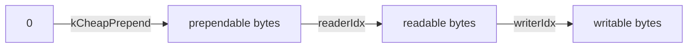

相关字符的意义如下:

| 字符                    | 意义         |
| --------------------- | ---------- |
| 0                     | 内存的起始位置    |
| `kCheapPrepend`(8 字节) | 提前空出的位置    |
| prependable bytes     | 空出的空间字节数   |
| readable bytes        | 当前可读的空间字节数 |
| writable bytes        | 当前可写的空间字节数 |


既然是缓存区, 肯定包含读写缓冲的功能. 首先是**读功能** `readFd(int fd, int *savedErrno)`, 从 fd 上读取数据, 在读取失败时写入错误码. 读功能我们没有使用 `::read()` 函数, 而是 `readv()`, 为了应对数据一次性读不完的问题, 我们额外准备了栈上的缓冲区 `extrabuf`(64 k), 这样就算 `buf` 写满了, 可以再写 `extrabuf`, 最后将多出的数据 `append()` 到 `buf` 中


写功能 `writeFd(int fd, int *savedErrno)` 比较简单, 使用 `::write()` 向 fd 写数据, 成功时值消费实际写出的字节, 至于重试等相关策略由上层调用者决定


其余的相关函数接口分别解决了什么, 这里用表格简单说明

|接口|行为|
|---|---|
|`append()`|保证空间、复制数据，再推进写索引|
|`hasWritten()`|记录新增的有效字节，只推进写索引|
|`peek()`|借用可读数据起点，不消费数据|
|`retrieve(len)`|消费指定字节，推进读索引；全部消费时复位|
|`retrieveAll()`|两个索引复位到 `kCheapPrepend`，保留存储空间|
|`retrieveAsString(len)`|复制指定数据到 string，然后消费|
|`retrieveAllAsString()`|复制全部可读数据，然后复位索引|


扩容函数 `makeSpace` 单独说明, 根据以下情况不同进行不同的处理

|情况|处理|
|---|---|
|尾部可写空间足够|直接追加|
|尾部不足，但加上前部可回收空间后足够|将可读数据搬到预留区之后，重新调整索引|
|回收后仍不足|扩大底层 vector 的大小|


**Buffer 拥有自己的存储空间, 由其所在作用域或拥有者管理生命周期; 作为 TcpConnection 成员时, 随连接对象一起销毁**


---
## TcpConnection -- 连接端

>TcpConnection(连接端), 一个已接入的连接对应一 TcpConnection, 组合 Socket、Channel 和 Buffer, 负责连接状态、非阻塞收发关闭流程以及业务回调


### 核心成员

+ `socket`: `std::unique_ptr<Socket>`, 封装 `connFd` (连接 fd) , 掌管其生命周期
+ `channel`: `std::unique_ptr<Channel>`, 封装 `connFd` 和 `callback` (回调事件), 相关回调由 TcpConnection 设置
+ `input/outputBuf`: 接收/发送缓冲区, `inputBuf` 保存已经读取、尚未被业务消费的数据. `outputBuf` 保存尚未交给内核的发送数据.
+ `Callback`: 各种回调函数, 其中有高水位回调, 防止发送过快


### 详细信息

`TcpConnection` 的生命周期由 `TcpServer` 负责,  `connections(ConnectionMap)` 存储 **连接名->TcpConnection** 的键值对,  连接表持有共享引用, 事件分发中的 guard、排队任务及应用代码也可能持有引用


其**生命周期**流程如下: `TcpServer` 将 `acceptor` 的新连接回调 `newConnectionCallback` 设置为 `newConnection`,  新连接到来时 `acceptor` 根据监听 fd 创建连接 fd, 同时执行新连接回调移交连接 fd 的所有权,  回调函数里面根据连接成功的 socketFd 创建 `TcpConnection` 对象,  设置 `TcpConnection` 的回调函数, 最后 `TcpServer` 析构时会释放 `TcpConnection` 的连接资源


既然有了 `channel` 频道可以进行连接的相关回调, **为什么还需要** `TcpConnection` 呢? 个人认为**原因**有以下几点


1. `channel` 仅借用不负责连接 fd, 而 fd 的又是由 `socket` 负责时, 所以要**组合**成 `TcpConnection`
2. `channel` 只负责事件的关心状态, 它并**不知道连接的状态**, 根据**高内聚低耦合**它也不应该管连接的状态, 所以 `TcpConnection` 维护枚举类 `StateE` 明确连接的状态
3. 数据的读写需要**缓冲区**, `channel` 相关回调写死缓冲区显然不太合适, 所以得由 `TcpConnection` 维护 `Buffer` 进行读写数据的缓存


这里给出连接的状态含义表

| 状态               | 含义                   |
| ---------------- | -------------------- |
| `kConnecting`    | 对象已构造，尚未完成建立流程       |
| `kConnected`     | 接受正常收发请求             |
| `kDisconnecting` | 正在关闭，不再接受新的发送请求      |
| `kDisconnected`  | 逻辑已关闭，fd 仍可能因共享引用而保留 |


`TcpConnection` 在连接建立时 `connectEstablished()` 将 `channel` 注册到当前 loop 的 poller 上, 同时使用 `tie()` 绑定当前 `TcpConnection` 对象, `channel` 开始观察 `TcpConnection` 对象的死活,  `TcpConnection` 自行组织 `handleRead/Write/Close/Error` 回调函数, 同时上层 `TcpServer` 设置的回调有的也会整合到自行组织的回调函数中, 最后将这些回调**注册**到 `channel` 中, 所以一个清晰的回调设置路径如下:

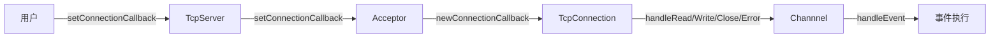


这里回收埋伏已久的伏笔, 还记得我们讨论 `Channel` 类的 `tie()` 函数吗, 这是留给 `channel` 观察 `TcpConnection` **是否存活的窗口**, 因为 `TcpConnection` 给 `channel` 设置的回调涉及操作连接的读写缓冲区 `output/inputBuf`, 如果 `TcpConnection` 对象已经销毁了, 这时 `channel` 还试图使用**不复存在**的 `output/inputBuf`, 结果如何没人知道, 最好的情况就是程序崩溃. 所以进行 `tie()` 绑定后通过调用 `lock()`(线程安全) 升级指针为强引用, 如果失败说明对象不存活了, 那就**什么都不做**. 下面这幅图清晰地给出了 `channel` 的 `handleEvent` 的执行图

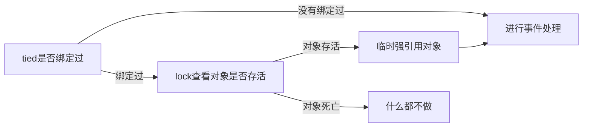


`TcpConnection` 的关闭接口比较多, 这里用表格给出区分职责

|接口|当前职责|
|---|---|
|`shutdown()`|进入 Disconnecting，已有输出排空后请求关闭写端，保留读取|
|`forceClose()`|排队进入关闭流程，不等待输出缓冲排空|
|`handleClose()`|禁用并移除 Channel，设置 Disconnected，依次通知下线和上层移除|
|`connectDestroyed()`|在所属 loop 完成清理，也支持取消尚未建立的连接及重复清理|


---
## TcpServer -- 连接服务端

 >TcpServer(连接服务端), 集大成之者, 负责维护 baseLoop, 设置连接监听 `acceptor`, 开启工作线程池 `threadPool` 以及保存所有已知的连接 `connections` 并为相关连接设置回调


### 核心成员

+ `loop`: baseLoop, 裸指针借用主线程, 不负责主线程生命
+ `acceptor`: `std::unique_ptr<Acceptor>` 运行在 baseLoop 中, 其中的 `listenFd` 被注册到 baseLoop 到 poller 中进行监听, 新连接到来时创建 `connFd` 并执行创建 `TcpConnection` 的连接回调
+ `threadPool`: `std::shared_ptr<EventLoopThreadPool>`, subLoop 线程池
+ `Connections`: `std::unordered_map<string, TcpConnectionPtr>`, 维护 连接名称->连接 的哈希表, 保存所有连接
+ `nextConnId`: 连接计数, 用来给连接进行计数命名


### 详细信息

既然是集大成者, 自然免不了繁琐的启动和销毁流程. 当前的正常连接与退出同步写在一起, 导致阅读成本变高, 我们重点理解以下两个原则, 再来看实现

1. 连接表归 baseLoop 管, 连接上的 channel 操作由连接所属的 ioLoop 执行
2. Server 可以结束, 但是已经在 loop 里面排队的任务不会因此消失


首先分清执行的线程、保存回调和执行回调

|执行位置|负责的事情|
|---|---|
|baseLoop|Server 构造、配置、启动、析构；Acceptor 接入；修改 `connections_`|
|连接所属 ioLoop|连接建立、读写、关闭及 Channel 清理|

没有工作线程时, ioLoop 就是 baseLoop, 但排队任务仍然能区分执行阶段.
对应代码的三种操作

```cpp
setXxxCallback(callback);    // 现在保存函数
xxxCallback(arg...);         // 现在调用已保存的函数
loop->queueInLoop(callback); // 保存到任务队列, 稍后由该 loop 执行
```

lambda 函数本身不创建线程. 它在何处执行取决于谁调用它, 或者它被提交到了哪个 loop 的任务队列 `pendingFunctors_` 中


来到**构造与启动**阶段, 构造负责准备相关资源, 启动负责驱动资源.
**构造函数** `TcpServer()` 主要负责这些事:

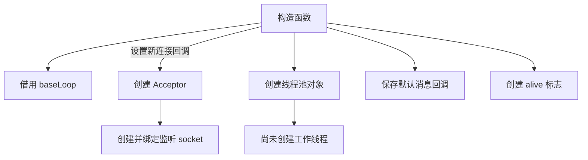

其中的设置新连接回调, 意思是: 每当 `Acceptor` 接入连接时, 调用当前 Server 的 `newConnection()`, 此时只是保存函数, 不涉及执行


**启动函数** `start()` 主要负责这些事:

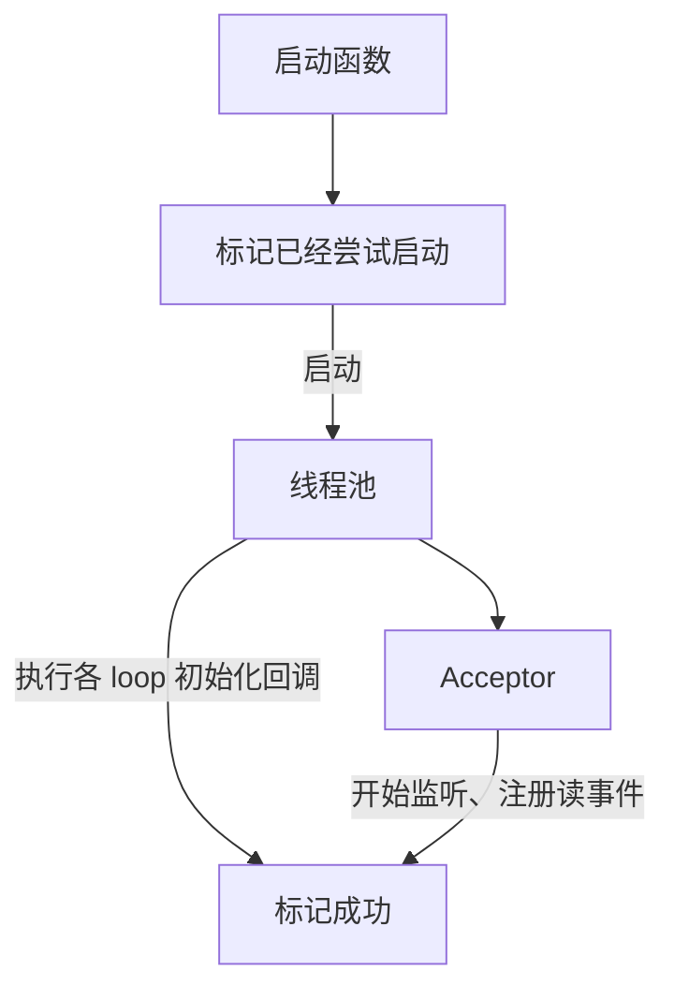

上述构造启动的图串行执行


然后是新连接回调 `newConnection` 负责接管 `Acceptor` 移交的 `connFd`, 从线程池轮询选出 `ioLoop` 并且创建 `TcpConnection`,  设置连接的业务回调以及关闭回调, 放入 `connections_` 中持有共享引用, 最后向 `ioLoop`提交 `connectEstablished()` .
有关的回调类型, 保存位置, 调用时机可见下表:

| 回调               | 保存在哪里         | 何时调用                                                                             |
| ---------------- | ------------- | -------------------------------------------------------------------------------- |
| 新连接回调            | Acceptor      | 接入成功后，在 baseLoop 调用 Server 的 `newConnection()`                                   |
| 连接状态回调           | TcpConnection | 在 ioLoop 通知上线、下线                                                                 |
| 消息回调             | TcpConnection | 在 ioLoop 读到数据后交给业务处理                                                             |
| 写完成回调            | TcpConnection | 在 ioLoop 的任务队列中通知业务                                                              |
| 内部关闭回调 `onClose` | TcpConnection | 正常关闭由 `handleClose()` 调用 `onClose`; 建立失败时由建立任务调用 `onClose`. 最后的移表才发生在 baseLoop 中 |

而正常断开时, 两次任务的投递, 会负责各自线程所需要取消的管理信息:

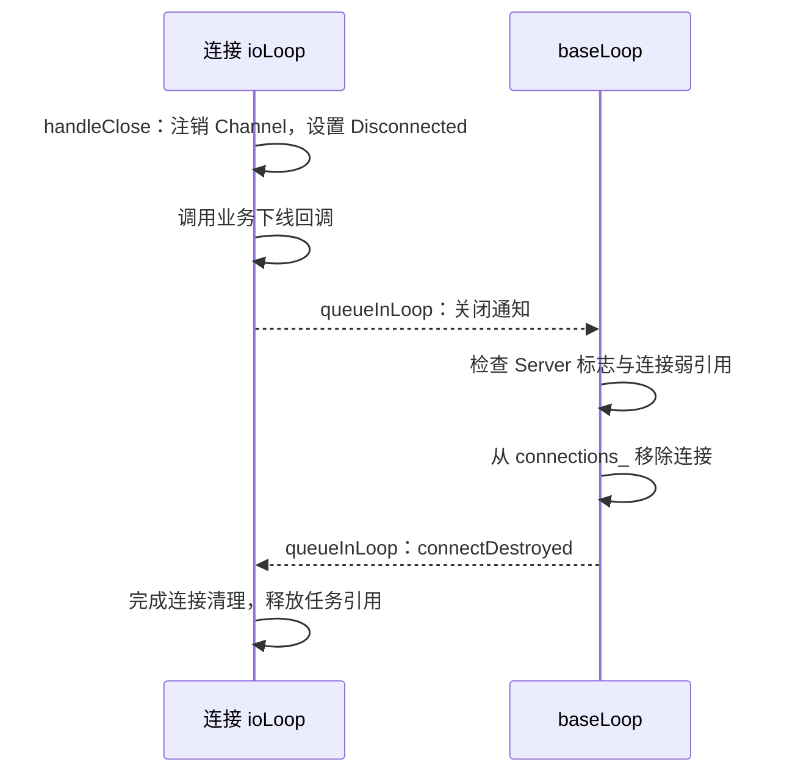


第一趟回 baseLoop, 是因为**连接表注销**只能由 baseLoop 执行; 第二趟回 ioLoop, 是因为连接清理需要 ioLoop 执行. 需要注意的是 `handleClose()` 已经注销了 Channel, 后续的 `connectDesroyed()` 完成**幂等**清理, 而 Server 主动析构连接时也会统一使用这个接口


接着是大量的强引用/弱引用计数指针, 以及回调函数过程中的按值传递. 前文提到的 `alive` 标志, 主要是防止旧通知访问已结束的 Server, 存在以下的变量和类型

```cpp
alive_ // shared_ptr<atomic_bool>: 独立存活的标志
weak   // weak_ptr<atomic_bool>: 观察这个标志
weakConn // weak_ptr<TcpConnection>: 观察连接
```

注意 `weak` 只观察标志而非观察 Server 对象本身, 所以不是 `weak_ptr<TcpServer>` 类型. 为什么需要它? 考虑一种情况, ioLoop 已经提交关闭通知, 而且通知还在 baseLoop 队列里, 如果 baseLoop 已经先执行了 Server 的析构, 再轮到旧通知的执行, 就会进行移除连接表的行为, 而 Server 已经析构死亡, 不存在连接表了, 程序会崩溃


所以观察以下代码

```cpp
const std::weak_ptr<std::atomic_bool> weak = alive_;
const std::weak_ptr<TcpConnection> weakConn = connPtr;
EventLoop* baseLoop = loop_;
auto onClose = [this, baseLoop, weak](const TcpConnectionPtr& connPtr) {
	// 工作线程不访问 Server；进入 baseLoop 并检查存活状态后才使用 this。
	baseLoop->queueInLoop([this, weak, weakConn] {
		auto flag = weak.lock();
		if (flag && flag->load()) {
			if (auto conn = weakConn.lock())
				removeConnection(conn);
		}
	});
};
```

第一层 `flag && flag->load()` 是确定 Server 是否存活, 第二层 `auto conn = weakConn.lock()` 是确定 TcpConnection 是否存活, 两者同时存活时才能进行连接表的注销. 而 `weakConn` 让关闭通知不额外延长连接生命周期, 当 Server 已经将连接清理时这条通知什么都不会做. 可以通过下面这幅逻辑图观察相关行为

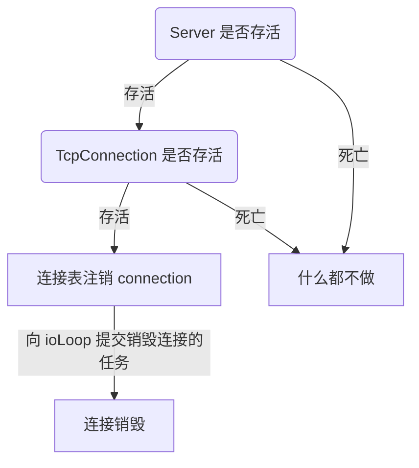


然后便是析构函数 `~TcpServer()`, 会先清理连接, 再允许工作 loop 退出. 同样给出流程图看清它负责什么事

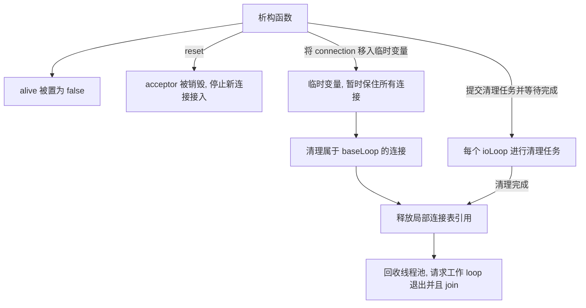

临时变量 `connections` 保留全部连接的强引用,  每个清理任务中的 `owend` 保存当前工作 loop 对应的一组连接. `owend == std::move(owend)` 位于 lambda 表达式的捕获中, 是将当前连接交给任务保存, 并没有移动 TcpConnection 对象, 也没有改变连接所属的线程.


工作 loop 清理会先清空 `CloseCallback()`, 再调用 `connectDestroyed()`, 这是因为 Server 已经将连接表移交给临时变量了, 无需再通知进行移表, 工作 loop 的清理只负责注销 Channel 而无需通知. **清空关闭回调只会影响之后的调用, 已经入队的旧通知仍然靠先前的 `alive_` 进行检查**. 同样清理任务一定会提交, 所以就算某个工作 loop 在连接表里面没有连接了, 清理任务仍旧会执行


想必你肯定注意到了 `promise/future` 机制, 一个负责**报告完成**, 一个负责**等待完成**. 两者只能一一对应. `promise` 承诺在未来给出结果完成的值或者信号, `future` 会阻塞等待先前承诺会给出的值或信号. 所以看析构函数中精简的代码

```cpp
auto done = std::make_shared<std::promise<void>>();
auto completion = done->get_future();

ioLoop->queueInLoop([ioLoop, done] {
    // 在 ioLoop 清理连接……

    ioLoop->queueInLoop([done] {
        done->set_value();
    });
});

completion.get();  // baseLoop 等待完成通知
```

`promise` 被工作 loop 拥有, 负责在清理完成后给出信号通知, 通过 `set_value()` 完成. `future` 被正在析构的 baseLoop 拥有, 负责阻塞等待清理完成后的通知, 通过 `get()` 等待确认. 而 `void` 不负责业务结果, 仅做 "通知" 的作用(这是模板偏特化导致的). 每个工作 loop 持有一个 `promise`, baseLoop 持有所有对应的 `future`, 并等待通知的到来


为什么需要**排二轮**的任务进行通知?因为`doPendingFunctors()` 会把任务批次交换到局部 vector 中. 某个任务已经调用完成, 不代表保存它的函数对象已经销毁. 我们需要再次提交任务, 保证上一批任务的函数对象已经销毁, 释放其捕获的连接强引用. 所以第二次排队确认的是：**包含清理任务的上一批任务已经整体结束**, 而确认任务只持有 `done`，不会再次把 `owned` 中的连接引用带过去


需要注意的是工作回调不能同步等待正在析构的 baseLoop, 否则会形成: baseLoop 等工作 loop 清理完成, 而工作 loop 又等 baseLoop 执行某项任务


最后解释 Server、工作 loop、连接 fd 的结束时刻. Server 不拥有 baseLoop，baseLoop 由应用管理. 工作 loop 在线程池回收过程中结束并析构. 连接 Channel 已完成注销后, TcpConnection 仍可能被应用的共享引用保留, fd 要等最后一个引用释放、Socket 析构时才关闭